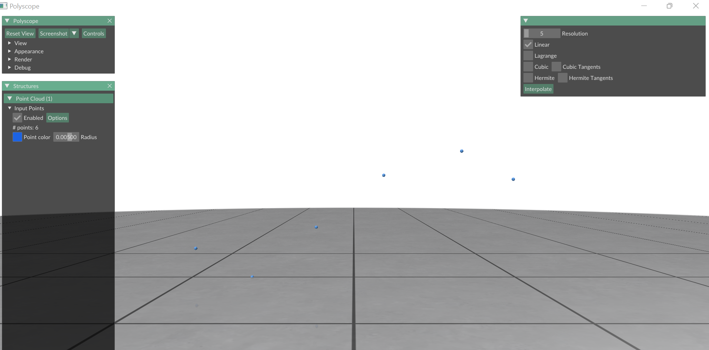
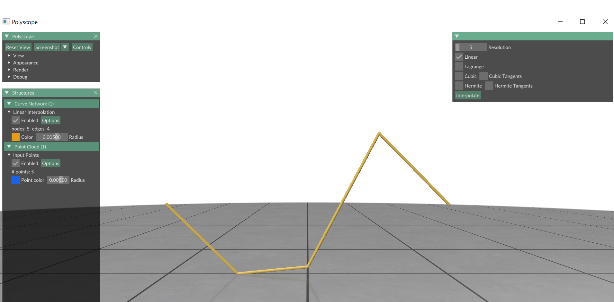
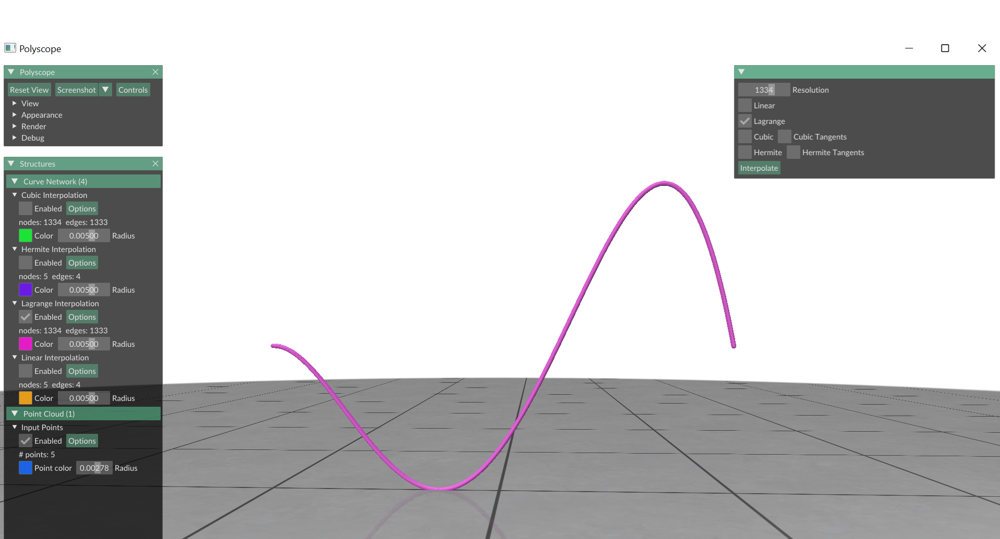
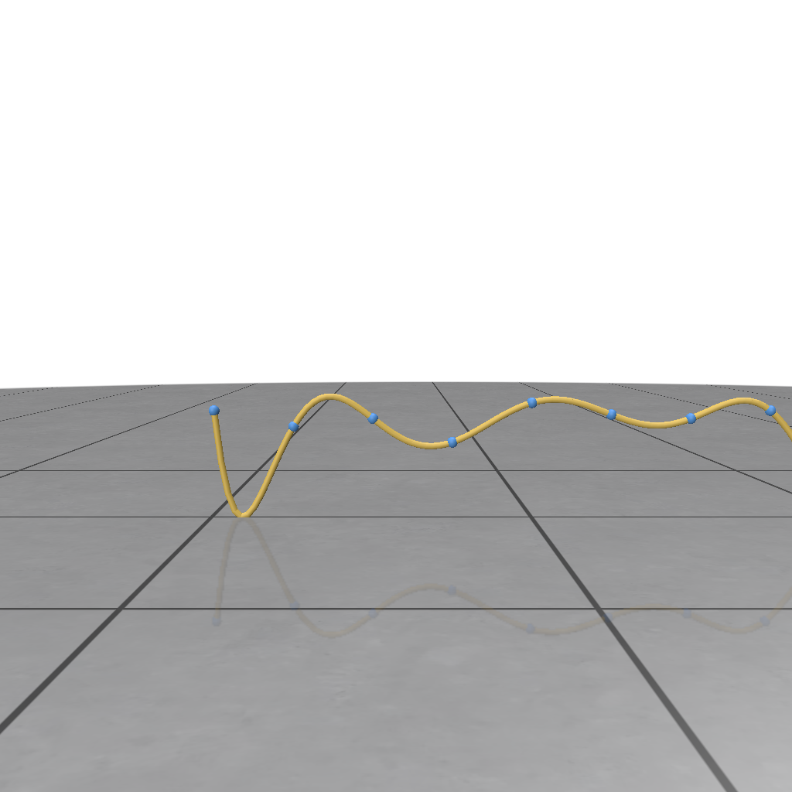
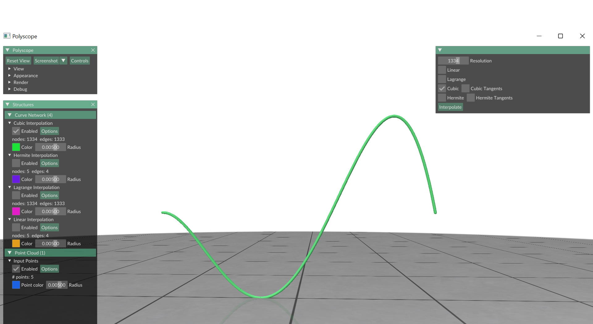
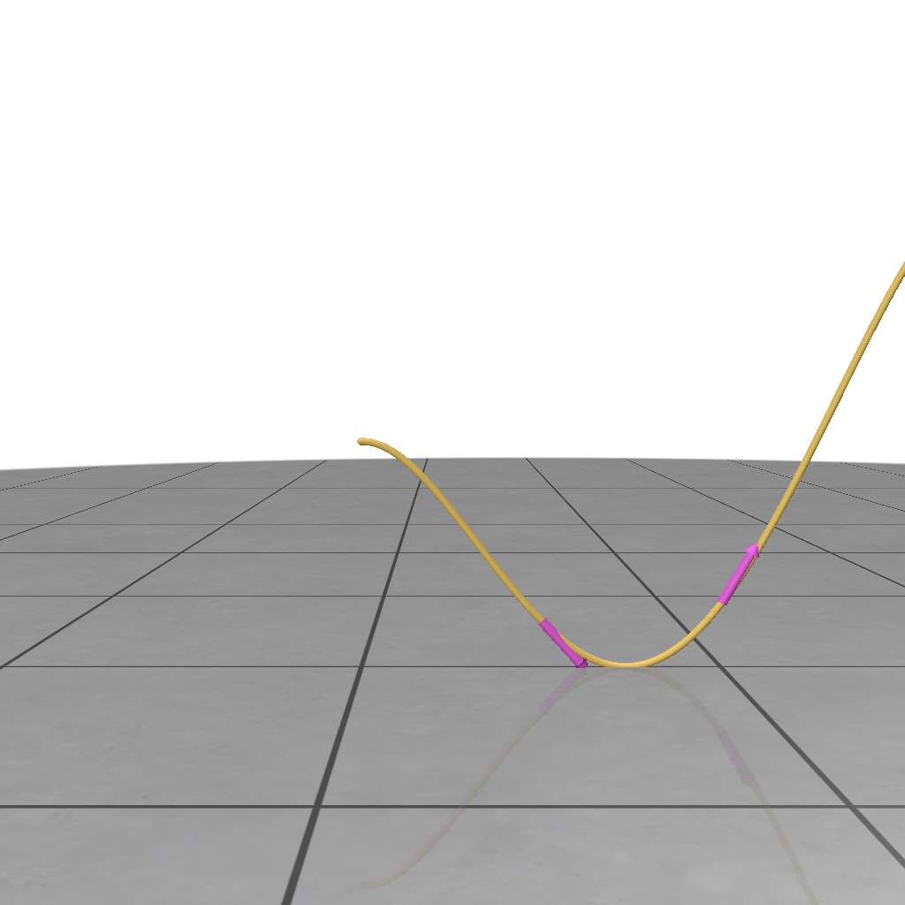
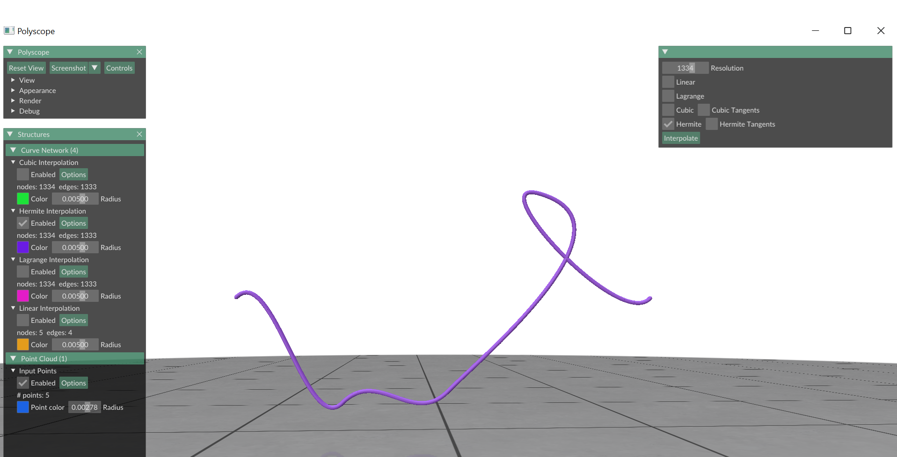

# TD 2 - A basic editor for curve interpolation

Examples of curve interpolation schemes (Lagrange and cubic spline interpolations)

## 0. Drawing curves

We will use Polyscope to visualize curves, which will be generated using various interpolation techniques that you will implement, applied to a given point set. 

The Interface: once each interpolation method is implemented, it will be accessible via the "Interpolate" botton.

As a little motivation. Curve interpolation is used in plenty of incredible vector graphics programs. This week you will learn how you can do that as well.

<video width="640" height="360" controls>
  <source src="imgs/TD2-illustrator-teaser.mp4" type="video/mp4">
  Your browser does not support the video tag.
</video>

### For you to do
All the tasks for today are in the `.cpp` files in the `src` folder. The `main.cpp` only needs to be changed for the bonus task.

### A quick note on abstract classes 
All the methods that you will implement today are different curve interpolation methods. Thus, in makes sense that they all inherit from a common class abstract class `CurveInterpolation`.  But the type of the interpolation has to be specified, thus it is the perfect use case for an abstract class.
Let us note that an abstract class is a base class in c++ that can itself not be instanciated, but may contain virtual functions, in our case `eval_function `. The implementation of these virtual functions need to be overwritten in the derived classes.
You cannot instanciate objcts of these abstract classes, but you can create pointers towards instances of these abstract classes. For instance you will see in the `main.cpp` that we create a shared pointer 
```cpp
std::shared_ptr<CurveInterpolation> interp; // pointer to the interpolation method
```
Now, we can let this pointer point towards instances of derived curve interpolation classes. For example, to create an instance that the pointer points to, can be done as follows:
```cpp
interp = std::shared_ptr<CurveInterpolation>(new LagrangeInterpolation(V1));
```

This is a very common technique to write modular code. Imagine you  would like to try out  another  new curve interplation method, you can simply add one new derived class, that inherits from the base class in your project.

## 1. Linear interpolation

Complete class `LinearInterpolation` and override the method `eval_function` which computes the value of the interpolation at time t. This function should be valid for t in  $[x_0,\ldots, x_{n-1}]$ where $x_0,\ldots,x_{n-1}$ are the points to be interpolated.


Example: linear interpolation of 5 points: $(x_0,y_0),\ldots,(x_4,y_4)$

## 2. Function interpolation

### 2.1 Lagrange interpolation: solve linear system of equations

Given a set of `n` points to interpolate, you have to solve a system of `n` equations (with `n` variables), represented in matrix form (as illustrated during the Lecture), as follows:
$$
\begin{pmatrix}
1& x_0& x_0^2&\cdots& x_0^{N-1}\\ 
1& x_1& x_1^2&\cdots& x_1^{N-1}\\
\vdots&\vdots&\vdots& &\vdots\\
1& x_{N-1}& x_{N-1}^2&\cdots& x_{N-1}^{N-1}
\end{pmatrix}\cdot\begin{pmatrix}a_0\\ a_1\\ \vdots \\ a_{N-1}\end{pmatrix} = 
\begin{pmatrix}
\Sigma_{k=0}^{N-1} a_k x_0^k\\
\Sigma_{k=0}^{N-1} a_k x_1^k\\
\vdots\\
\Sigma_{k=0}^{N-1} a_k x_{N-1}^k
\end{pmatrix}
$$

Complete the class `LagrangeInterpolation` by implementing the constructor. Compute the Vandermonde matrix `W` using the `Vandermonde` method and the method `eval_function` for the Lagrange interpolation.


Example: Lagrange interpolation of 5 points $(x_0,y_0),\ldots,(x_4,y_4).$

The goal is to compute the coefficients of the polynomial expression for $f(x)$, by solving a linear system of equations.

The sequence of images below illustrates some drawbacks of Lagrange interpolation:


Example: Lagrange interpolation of 5 points: $(x_0,y_0),\ldots,(x_4,y_4)$
### 2.2 Cubic spline interpolation: matrix form

Given a set of $n$ points to interpolate, you have to solve a system of $4(n-1)$ equations (with $4(n-1)$ variables), represented in matrix form as below.

Complete class `CubicInterpolation` implementing the cubic spline interpolation.


Example: cubic spline interpolation: $(x_0,y_0),(x_1,y_1),(x_2,y_2),(x_3,y_3),(x_4,y_4)$. 

Suppose we are given $N+1$ points $(x_0,y_0),\ldots,(x_N,y_N)$ and the $i$-th polynomial segment is described through $f_i(x) = a_i + b_i x + c_i x^2 + d_i x^3$. Then with the given positions of the points, the given derivative values at the start and end and the fact that the derivative of the polynomials at the interior points should coincide, you can build a linear system to solve for the coefficients of the polynomials through:
$$
A\cdot \begin{pmatrix}a_0\\b_0\\c_0\\d_0\\ \vdots \\a_{N-1}\\b_{N-1}\\c_{N-1}\\d_{N-1}\end{pmatrix} = b.
$$

Solving this linear system will allow you to complete the function `eval_function` in the class `CubicInterpolation`.

### 2.3 Drawing tangents

Complete the function `eval_tangent()` of the class `CubicInterpolation` in order to draw the tangent vectors (at interpolated points).




### 3) Hermite cubic spline interpolation

Now, let us suppose we are given:
- a set of $n$ points to interpolate (added by the user in the frame),
- a set of $n$ vectors $\{t_i\}$, where $t_i$ is tangent to the curve at point $p_i = (x_i,y_i).$

**Remark:** for the sake of simplicity, the slopes (the $n$ vectors $\{t_i\}$) are provided as predefined parameters in the code (they are constant).

**Goals and Constraints:** we want to find a cubic parametric curve $f(t)=(x(t), y(t))$, such that:
- $f$ interpolates points, i.e $p_i=(x_i,y_i)$,
- $f$ respects $\mathcal{C}^1$ constraints (given by the tangents),
- Complete class `HermiteInterpolation` implementing the Hermite cubic spline interpolation.

**Suggestion:** As before, we suggest solving the problem in its matrix form, recalling that you should use the curve parametrization:
$$
f(t) = (x(t),y(t)).
$$
The $x-$component and the $y-$component are to be treated as polynomials themselves. As in the prior case of the spline interpolation:
$$
x(t) = a_x + b_x t + c_x t^2 + d_x t^3,\quad y(t) = a_y + b_y t + c_y t^2 + d_y t^3.
$$
Since the slopes at each point are given in this case, the linear system for the individual curves will not be coupled. It suffices to solve systems of the form:
$$
W_x\cdot \begin{pmatrix}a_x\\b_x\\c_x\\d_x\end{pmatrix} = \begin{pmatrix}x(0)\\ x(1)\\ x-\text{coordinate of the slope at }p_0\\x-\text{coordinate of the slope at }p_1\end{pmatrix}.
$$
In the same manner, a linear system for the coefficients of $y(t)$ can be solved. This allows you to complete the functions `solve_x` and `solve_y` in the class `HermiteInterpolation`.


Example: Hermite cubic spline interpolation of `5` points: $(x_0,y_0),\ldots,(x_4,y_4)$. The goal is to compute parametric expressions for $f_0,f_1$.

### 3.2 Drawing tangents

As a bonus, add the method in the class `HermiteInterpolation` to draw the tangent vectors (at interpolated points).


