# TD 3 - Modeling 3D Shapes with Bézier Curves

## How to Model Simple 3D Shapes?

The goal of this TD is to provide a quick overview of Bézier curves.


### 1) Rendering Bézier Curves

Today, you will complete the class `Bezier` in `Bézier.cpp`. The file `main.cpp` provides functions for reading input data and performing tests.

---

For the first basic task, we want to compute a Bézier curve. By *computing*, we mean evaluating the curve `B(t)` for a given parameter `t` in `[0..1]`. We suggest implementing the iterative version of the *de Casteljau* algorithm, though other methods are also valid.

**Remark**: A Bézier curve is represented by its control polygon (the input to your program), stored in a `MatrixXd` with `n` rows and 3 columns (since we are working in 3D).
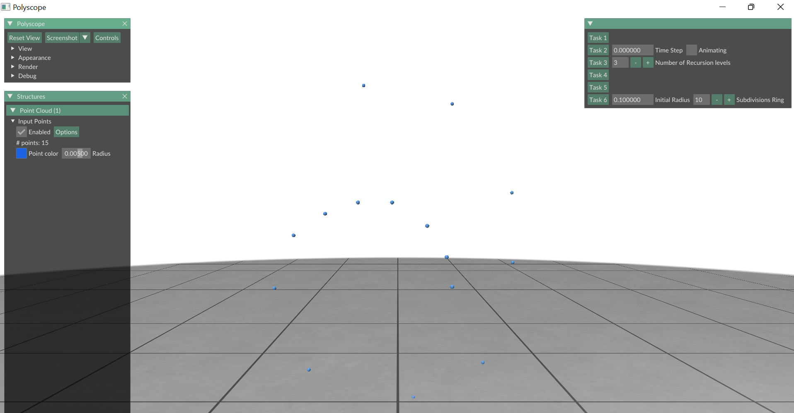
The Interface

Complete the function `de_casteljau(...)`:

```cpp
MatrixXd de_casteljau(const MatrixXd &V, double t)
{
  int nV = V.rows();         // Number of points in the control polygon
}
```

This function should return a `MatrixXd` with 1 row representing the 3D point `B(t)`.

Next, you need a function for rendering the Bézier curve. A basic approach is to compute a uniform sampling of the curve and use a polyline to render it.

Complete the function `plot_curve(...)`:

```cpp
MatrixXd plot_curve(const MatrixXd &V, int k)
{
  // TODO
}
```

This function should return a `MatrixXd` with `k` rows, each representing a 3D point on the Bézier curve.

The `test1()` function in `main.cpp` renders a Bézier curve. If you are using Mac or Linux, run the following command to test it (your program requires the name of a `.ply` file containing a 3D point cloud):

```bash
INF574/TD/TD3/build$ ./bin/td_3_executable /data/cubic.ply
```
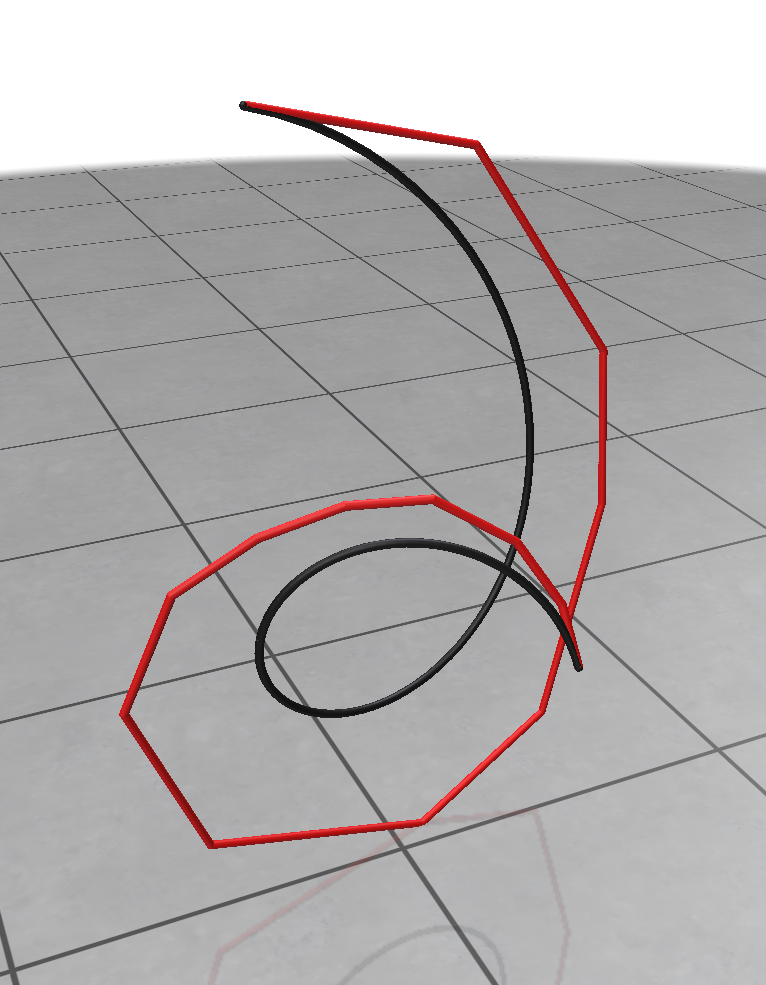
Result of Task 1

---

## 2a) Visual Debbugging with Polyscope of the de Casteljeau algorithm
You have maybe seen in the lecture the animation visualizing the recursive definition of the Bezier curves. 
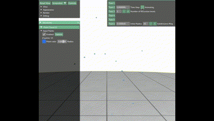

In the first part of Task 2 we will visually follow this and draw the intermediate steps that are needed to evaluate the bezier curve.
In this task, you should visually debug the recursion first and then re-create this beautiful animation. When you choose a time parameter $t\in [0,1]$ and click on the button for Task 2a) you will see that (when your implementation works hopefully) the first set of segments are drawn that you obtain from the first recursion iteration.

You will see in the `main.cpp` `task2a` that there is within a loop the `polyscope::show()` command. This draw all polyscope structures at this moment. You can now click on the close window button of your application and you will see that the window re-appears with a new set of segments. This is a very helpful way to visually debug your code. In particular when you have a geometric quantity that has to be constructed wthin a loop. There are tons of things that can go wrong, a flipped sign, a forgotten special case, but when you can identify in detail why and where your code fails, it is the first big step to write a working code and it will be useful in the following assignements that are to come. 

The pseudo code for the test2a method in the main.cpp could look as follows 
```cpp
void test2a(time_step):

    // Create a Bezier curve object
    initialize a Bezier object
    // Prepare containers for visualization data
    create empty list of curve points
    create empty list of edges
    create empty list of colors
    // Add the initial control polygon (in red)
    add_curve(V1, points_list, edges_list, colors_list, color = red)
    // Copy control points
    V2 ← V1
    // While more than one control point remains
    while (number of rows in V2 > 1):

        // Compute one intermediate step of De Casteljau’s algorithm
        V2 ← de_casteljau_intermediate(V2, time_step)

        // Add this intermediate polygon (in blue)
        add_curve(V2, points_list, edges_list, colors_list, color = blue)

        // Evaluate and plot the current Bezier curve up to time_step
        curve_points ← plot_curve(V1, num_samples = 100, time_step)

        // Take the last evaluated point as the “current position” on the curve
        eval_point ← last row of curve_points

        // Add the current curve segment (in green)
        add_curve(curve_points, points_list, edges_list, colors_list, color = green)

        // Register all current curves for visualization
        register a curve network in Polyscope with:
            name = "Bezier Curve"
            vertices = points_list
            edges = edges_list
            color = colors_list

        // Show the updated visualization
        polyscope::show()

    // Finally, register the control points for visualization
    register a point cloud in Polyscope with:
        name = "Control Points"
        vertices = V1

```

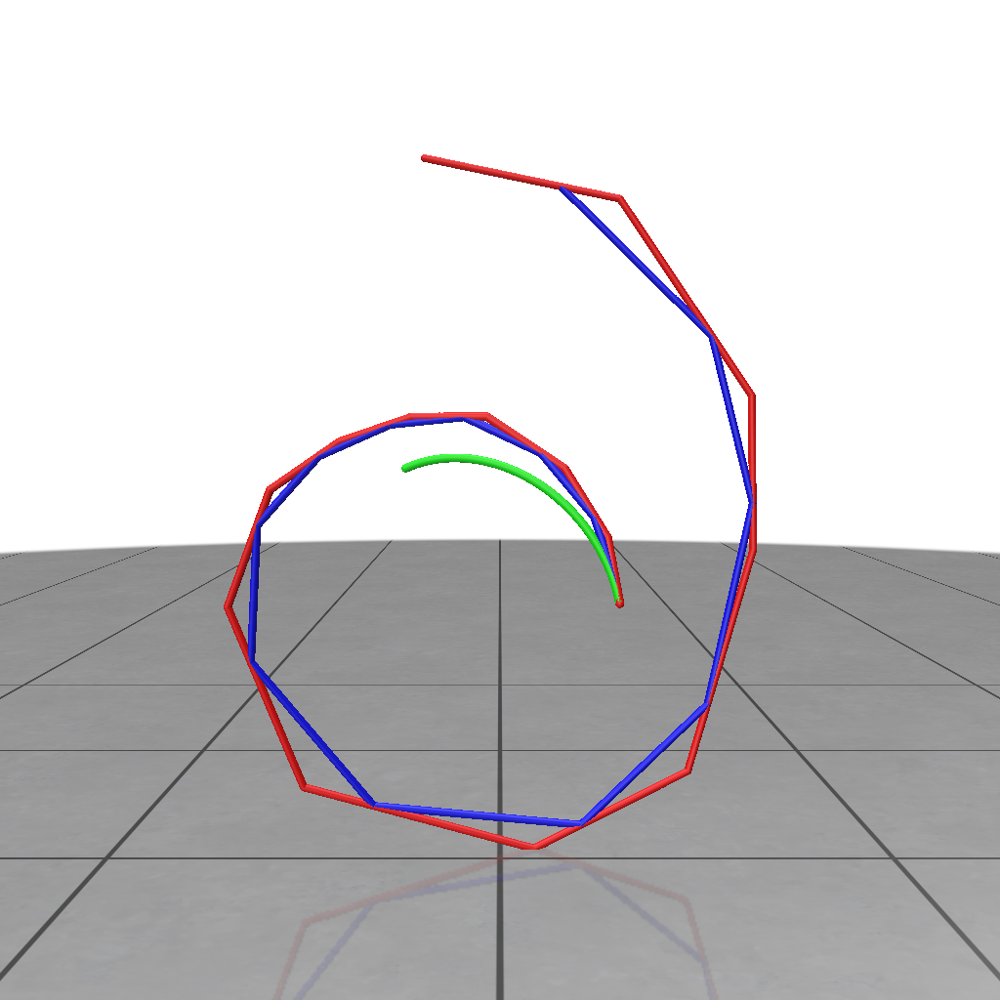
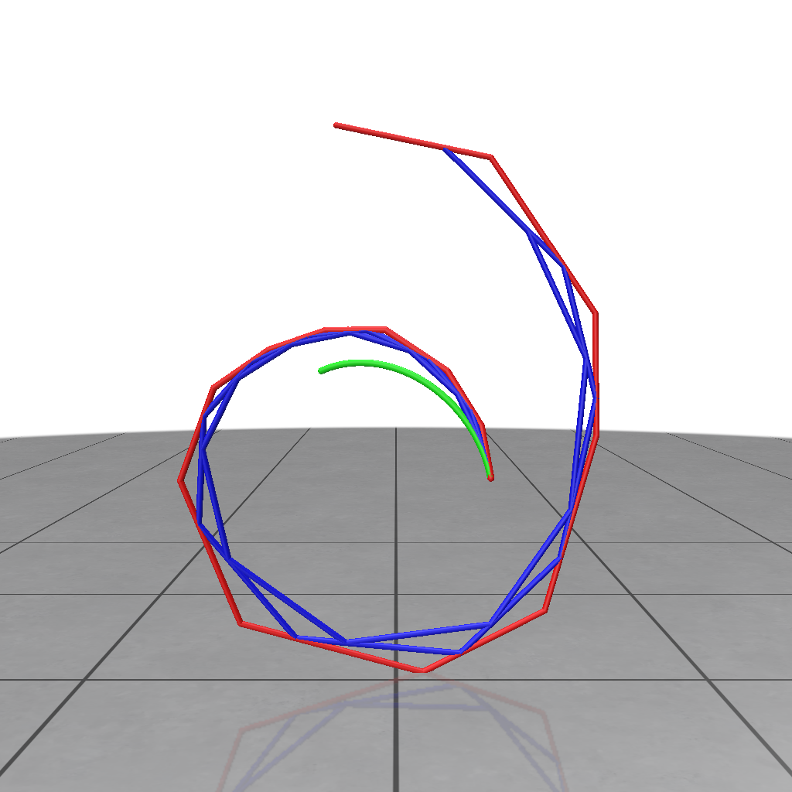
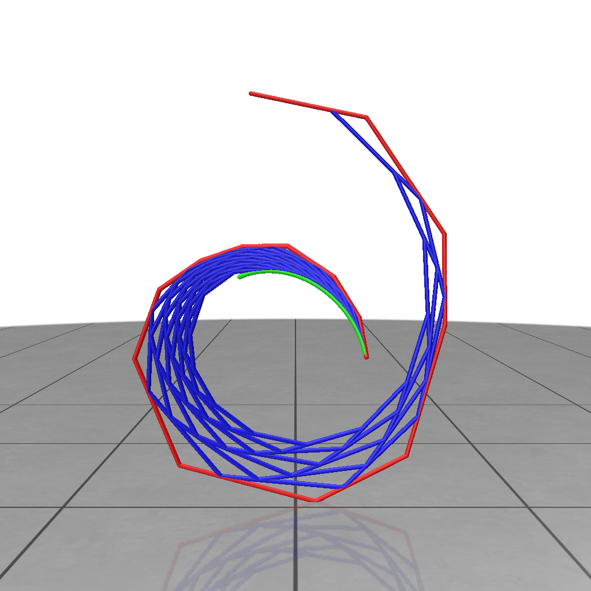
### 2) Visualizing de Casteljau's Algorithm

Now complete the function `test2` to create the intermediate polygons that visualize the recursive steps of de Casteljau's Algorithm. Attach these polygons to the `curve_renderer`, which is passed by reference to the function. Read and understand the methods in the `Util` class to accomplish this.

Create an animation (e.g., a `.gif`) to demonstrate the recursion in de Casteljau's algorithm.


---


### 3) Splitting a Bézier Curve

Subdivision is a crucial operation for Bézier curves, allowing us to split the curve or perform efficient rendering using recursive subdivision.

Complete the function `subdivide(...)`:

```cpp
vector<MatrixXd> subdivide(const MatrixXd &V, double t)
{
  // TODO
}
```

This function should return a `std::vector` containing 2 Bézier curves, each represented by a `MatrixXd`.

**Remark**: The function should compute the two Bézier curves using a recursive approach.

For a cubic Bézier curve, you will obtain 2 curves, each with fewer control points than the input curve. The subdivided Bézier curves must be returned in a vector. If the control polygon has 4 points, the function should return a vector of size 2 containing 2 matrices with 4 rows.

---
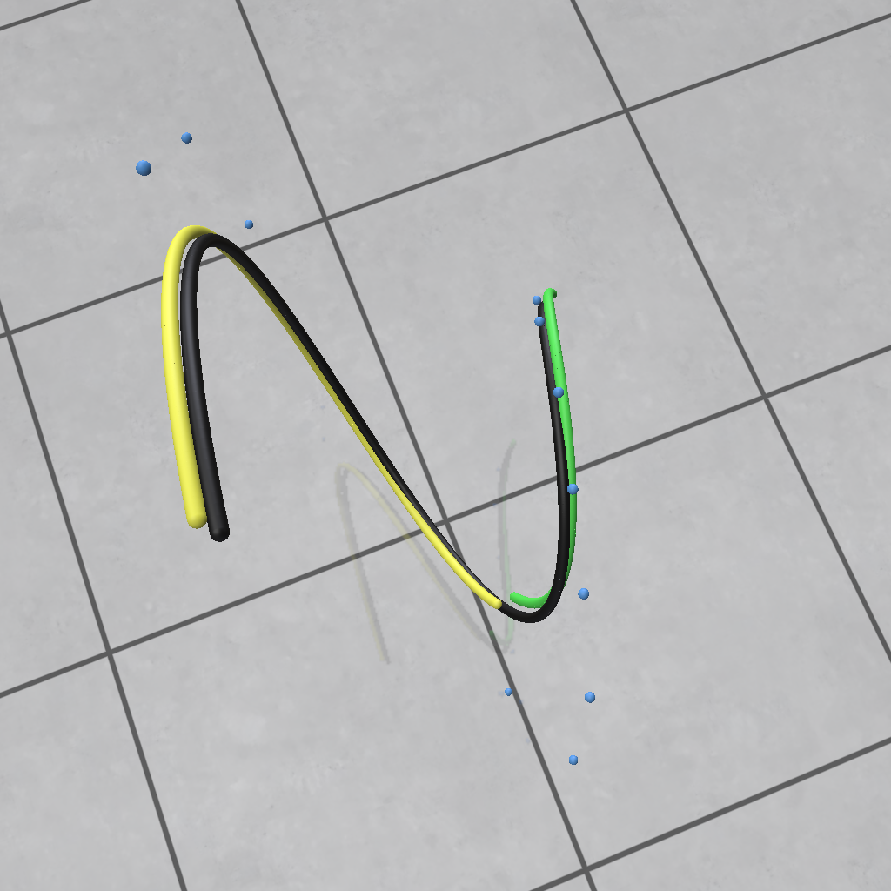
Result of Task 3

### 4) Rendering with recursive Subdivision

Another way for rendering Bézier curves is to perform recursive subdivision.
To complete this task it will suffice to complete the function subdivision_plot:
```cpp
MatrixXd subdivision_plot(const MatrixXd &V, int k)
{
  //TODO
}
```
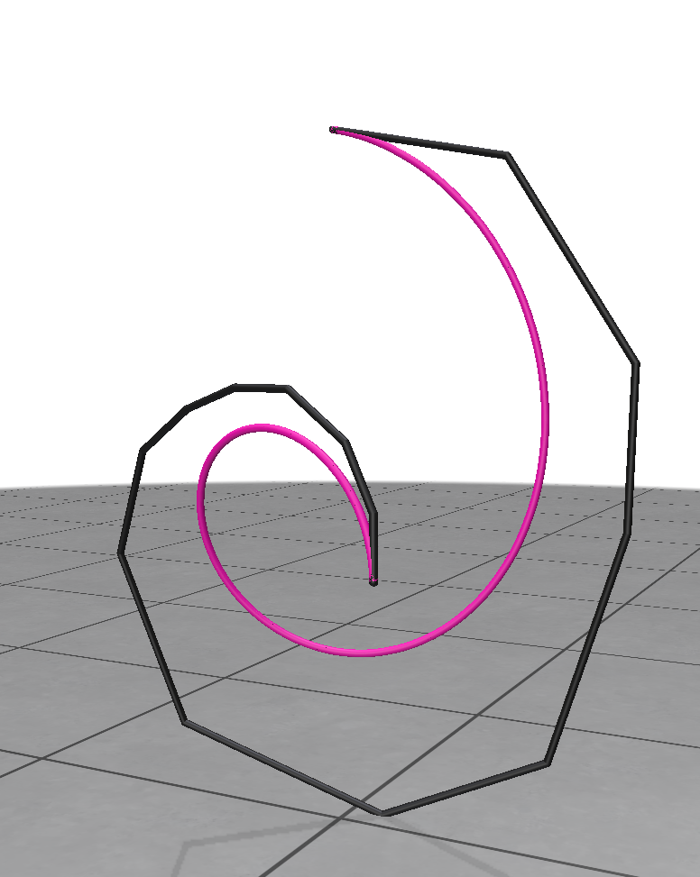                       
                      
that must return a MatrixXd storing the concatenation of all vertices of the control points of all the 2k curves, obtained subdividing the curve $C(t)$.

Use the test4() function to check your implementation.

### 5) Tangents and normals


To complete this task it will suffice to complete the functions:

```cpp
MatrixXd compute_tangent(const MatrixXd &V, double t0)
{
}
```

and

```cpp
MatrixXd compute_normal(const MatrixXd &V, double t0)
{
}
```

These must return, respectively, the tangent and normal vectors of the input curve `B(t)` for `t=t0`. Note that you should use the de Casteljeau Algorithm for that. The result is stored in a `MatrixXd` having 1 line.

To do that, we remind that Bézier Curves can be defined recursively. For a given set of control points $b_0,\ldots, b_n$ and a curve parameter $t \in [0,1]$, the Bézier Curve $\mathcal{C}(t)$ of degree $n$ is given by:

$$
\mathcal{C}(t) = b^n_0,
$$
where $b^0_i = b_i$ and $b^j_i = b^{j-1}_i (1-t) + b^{j-1}_{i+1} t$.

Expressing this recursive definition solely in terms of $b_i$ yields:

$$
\mathcal{C}(t) = \sum_{i=0}^{n} b_i B_{i,n}(t) \qquad (1),
$$

where $B_{i,n}$ are polynomials of degree $n$.

Calculate the derivative of the curve $\mathcal{C}$ in the form given in (1) on paper, which will yield a novel Bézier Curve of degree $n-1$ with different control points. Feed these novel control points subsequently to the function `de_casteljau(const MatrixXd &V, double t)` to evaluate the derivative of the Bézier Curve. The normals can be calculated similarly by calculating $\mathcal{C}''$.

Use the `test5()` function to check your implementation: you should see green and yellow segments, representing tangent and normal vectors, respectively.
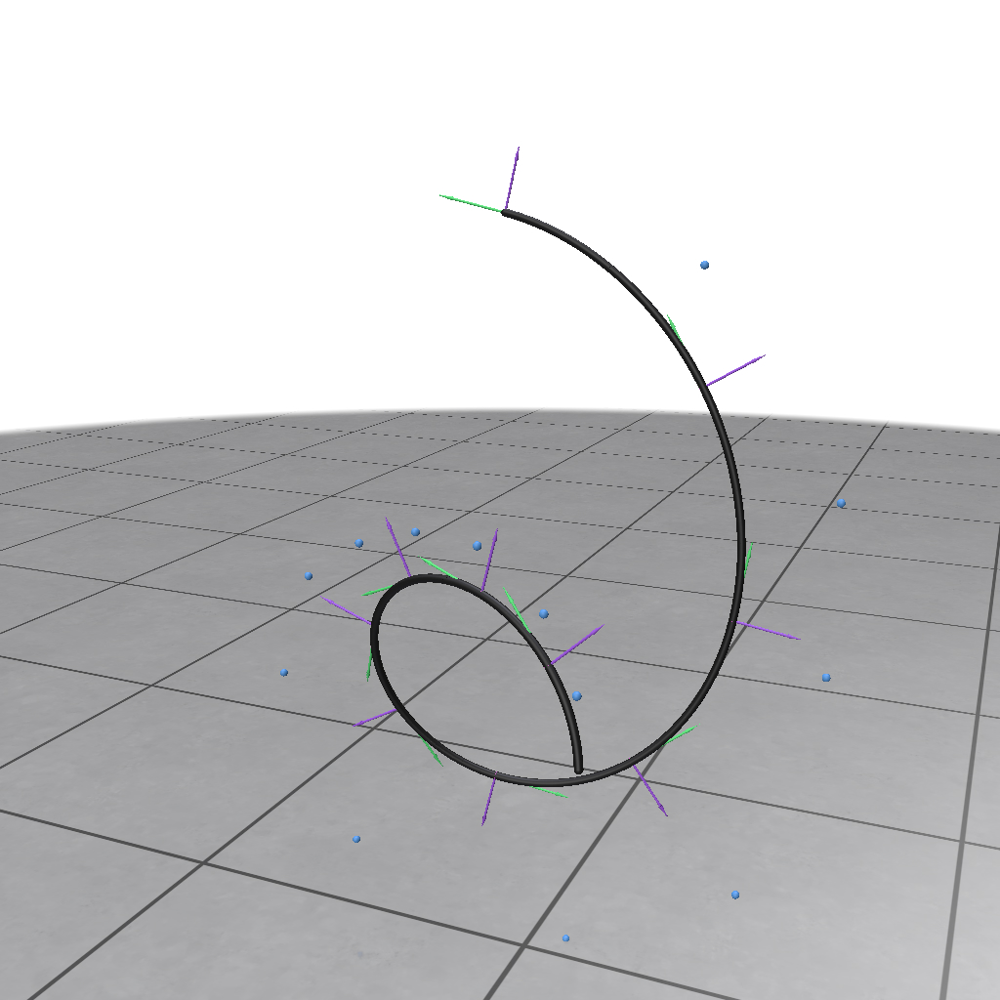

**Important remark:** Eigen provides functions for computing the `cross product` only for 3D vectors. You have to use the `Vector3d` type and make conversions from/to the `MatrixXd` type.

---

### 6) 3D hair modeling

A more practical and nicer way of rendering 3D Bézier curves is to use a thin cylinder (as in the picture at the top of this page). To construct a 3D mesh representation of the curve, we need first a collection of `k` loops of vertices, each representing a circular section of the cylindrical mesh. 


To complete this task, it will suffice to complete the function:

```cpp
MatrixXd compute_loop_of_vertices(const MatrixXd &V, double t0, int k, double radius)
{
}
```

This function must return `k` points (a loop lying on a circle) belonging to the hyperplane orthogonal to the input curve and passing through the point `B(t0)`. The result is stored in a `MatrixXd` having `k` lines.

Use the `test6()` function to check your implementation.

To show the skeleton of the cylinder mesh, uncomment this command (in the `test5()` function):

```cpp
curve_renderer.draw_cylinder_grid(loops, h);
```


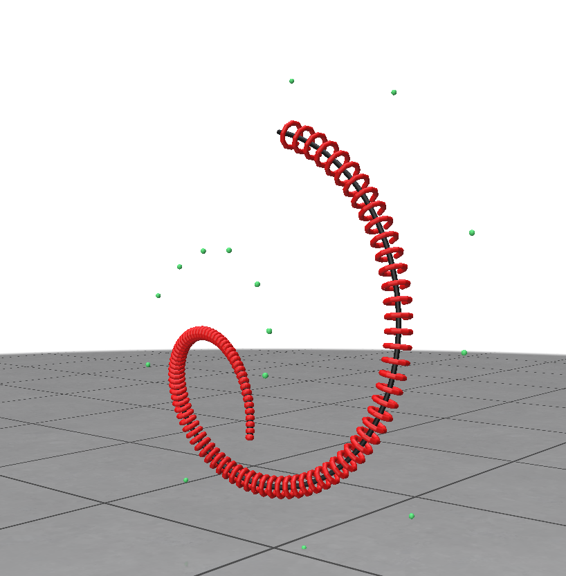
Result of Task 6

# Bonus
As you have seen in class, Bezier curves are often used for the creation of fonts. Create a .ply containing the control points of a Bezier curve that form a letter/character from your alphabet (and make it a bit interesting, do not just take the letter I). 
Attach a screenshot of the display of the curve to your submission and add the ```.ply``` file to the data folder and impress us with your artistic creativity.


Here, for your inspiration are some creations of latters from last years students


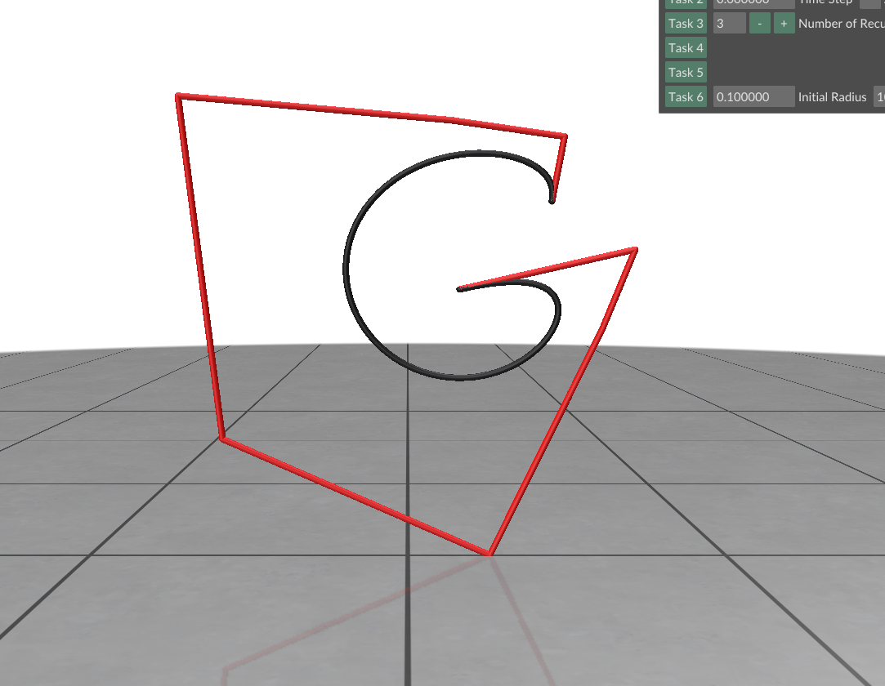
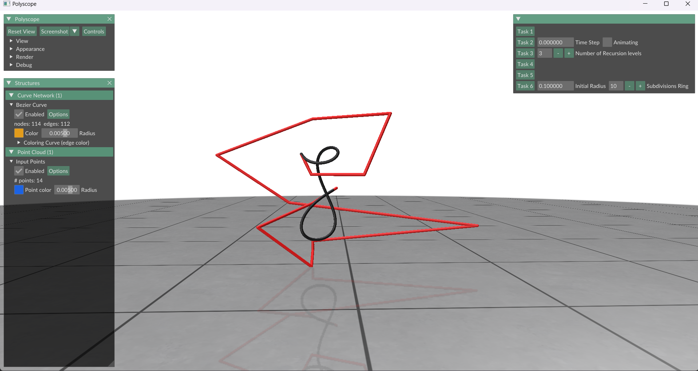